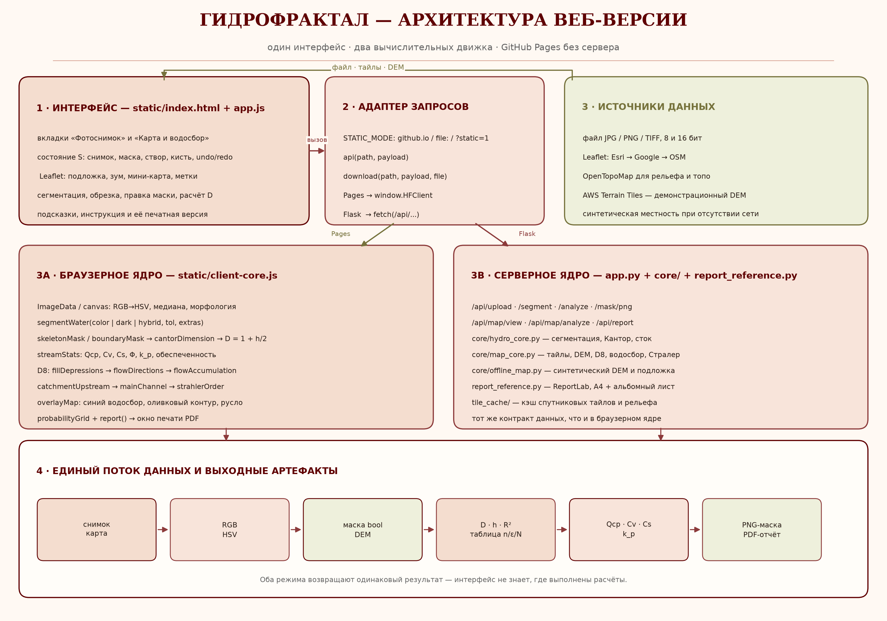
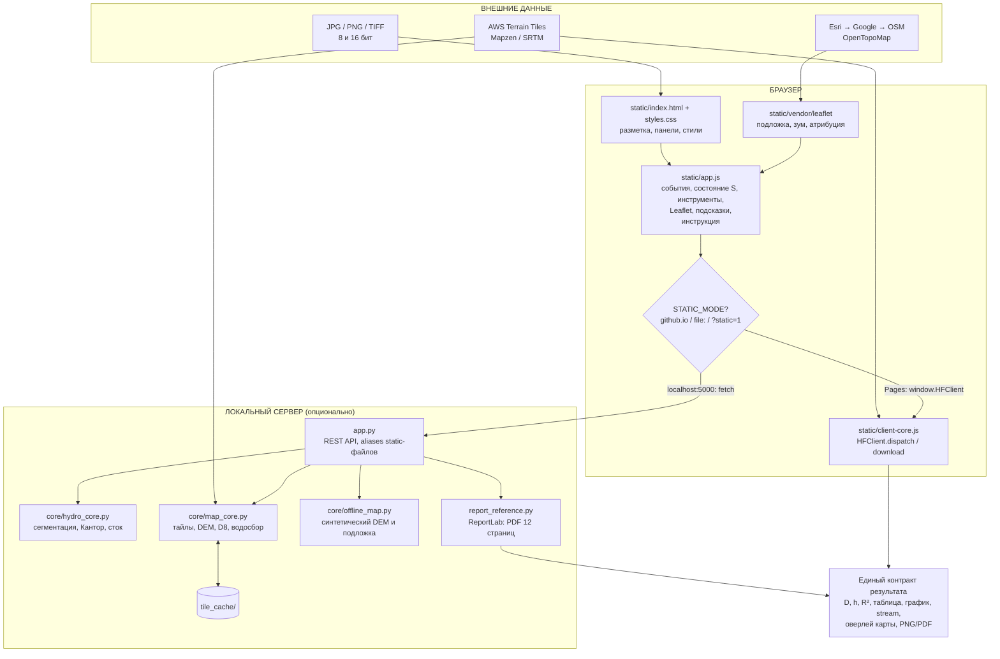
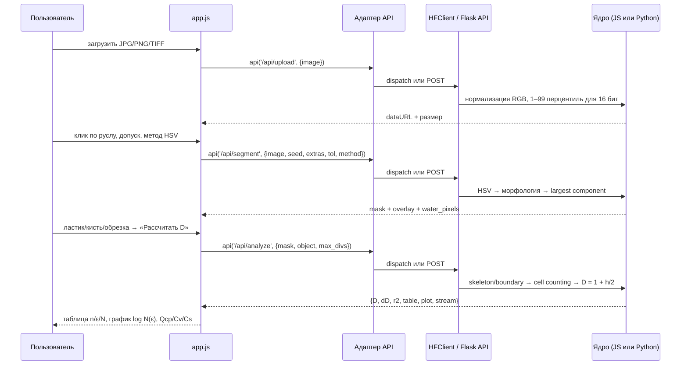

# Архитектура HydroFractal Web

Это техническая карта проекта: как устроен сайт, где выполняются расчёты, какие
данные передаются между слоями и почему существуют два вычислительных движка.



> Векторный исходник схемы — [`arhitektura_web.svg`](arhitektura_web.svg).
> Схема для оригинального настольного приложения сохранена в `arhitektura.png`.

---

## 1. Главная идея

HydroFractal Web — это **один пользовательский интерфейс и два взаимозаменяемых
вычислительных слоя**:

1. **GitHub Pages** — статический режим. Сайт открывается по адресу
   <https://rinhaizaki.github.io/HydroFractal/>, сервер отсутствует. Все расчёты
   выполняются в браузере модулем `static/client-core.js`.
2. **Локальный Flask** — серверный режим. Тот же интерфейс обращается к REST API
   `app.py`, который использует оригинальные алгоритмы из `core/` и формирует
   эталонный PDF через `report_reference.py`.

Интерфейс не знает, где именно посчитан результат: `static/app.js` вызывает
универсальные функции `api(path, payload)` и `download(path, payload, filename)`,
а адаптер выбирает способ выполнения по флагу `STATIC_MODE`.

---

## 2. Принципы проектирования

| Принцип | Как реализовано |
|---|---|
| Сохранить алгоритмы оригинала | Вычисления перенесены в браузер без изменения формул: HSV-сегментация, метод Кантора, D8-гидрология, статистика стока. Python-версия остаётся эталоном. |
| Работать без бэкенда | GitHub Pages отдаёт только `static/`; `_config.yml` задаёт `source: static`. |
| Не ломать CORS | Тайлы загружаются как обычные `` / через локально вендорированный Leaflet, а не через `fetch` с `mode: 'cors'`. |
| Единый формат отчёта | И браузерный, и серверный генератор принимают один и тот же `payload` и сохраняют структуру эталонного PDF. |
| Устойчивость к сети | Есть цепочка резервных источников тайлов, таймауты, синтетический DEM и демо-снимок. |
| Версионирование ассетов | В `index.html` подключены `styles.css?v=…`, `client-core.js?v=…`, `app.js?v=…` — это обходит кэш Pages после обновлений. |

---

## 3. Компонентная схема



### Слои и файлы

| Слой | Файл | Ответственность |
|---|---|---|
| Разметка | `static/index.html` | Две вкладки, три панели инструментов, холсты, модальное окно инструкции, подключение Leaflet и скриптов. |
| Оформление | `static/styles.css` | Палитра из образца, адаптивность, стили Leaflet, скрытие флага в атрибуции, состояние активных кнопок. |
| UI-логика | `static/app.js` | Состояние `S`, загрузка файла, кисть/ластик, undo/redo, обрезка, поворот, zoom/pan, мини-карта, метки, вызовы API, инструкция. |
| Браузерное ядро | `static/client-core.js` | Полная JavaScript-реализация расчётов и генерация печатного HTML-отчёта для GitHub Pages. |
| Карта в браузере | `static/vendor/leaflet/` | Локально вендорированный Leaflet 1.9.4 — подложка и навигация без внешнего CDN. |
| Сервер | `app.py` | Flask-приложение, валидация входных данных, REST-маршруты, локальная отдача статики. |
| Гидрология | `core/hydro_core.py` | HSV-сегментация, скелет/контур, клеточный счёт Кантора, оценка Q/Cv/Cs, PNG маски. |
| Карта | `core/map_core.py` | Тайлы, DEM, гео-привязка, заполнение впадин, D8, водосбор, русло, Стралер, оверлей. |
| Резерв | `core/offline_map.py` | Детерминированный синтетический рельеф и подложка, если сеть недоступна. |
| Отчёт | `report_reference.py` | Канонический ReportLab-отчёт: разделы I–VII, таблицы 1–5, рисунки 1–4, формулы и клетчатка. |
| Конфигурация Pages | `_config.yml` | Указывает GitHub Pages использовать каталог `static/` как корень сайта. |
| Fallback | `index.html` | Перенаправление на `static/index.html`, если Pages собран из корня репозитория. |

---

## 4. Выбор режима выполнения

`static/index.html` на этапе загрузки вычисляет:

```js
window.HF_STATIC =
  /github\.io$/i.test(location.hostname) ||
  location.protocol === 'file:' ||
  /[?&]static=1/.test(location.search);
```

`static/app.js` использует этот флаг в двух функциях:

```js
async function api(path, payload) {
  if (STATIC_MODE) return window.HFClient.dispatch(path, payload || {});
  // иначе fetch(path, { method: 'POST', ... })
}

async function download(path, payload, filename) {
  if (STATIC_MODE) return window.HFClient.download(path, payload || {}, filename);
  // иначе fetch → blob → <a download>
}
```

Таким образом, один и тот же вызов, например `api('/api/analyze', {...})`,
на живом сайте попадает в JavaScript-ядро, а при локальном запуске — в Flask.

---

## 5. Потоки данных

### 5.1. Работа со снимком



### 5.2. Работа с картой

1. Leaflet показывает спутник или топокарту; при ошибке тайлов включается
   резервная цепочка источников. Флаг в атрибуции скрыт CSS, текст источника
   сохранён.
2. `app.js` собирает `mapParams()`: центр, zoom, размер, источник, флаг рельефа.
   Если Leaflet уже рисует подложку, передаётся `skip_tiles: true`, чтобы ядро
   не загружало тайлы повторно.
3. Ядро получает DEM (AWS Terrain Tiles или синтетический) и строит конвейер:

```text
fillDepressions → flowDirections (D8) → flowAccumulation
    → catchmentUpstream → mainChannel → strahlerOrder
    → cantorDimension(main_line) → overlayMap → streamStats
```

4. Результат содержит площадь водосбора, длину русла, порядок Стралера,
   `area_km2`, `channel_km`, `preview_cells`, `cell_m`, `dem_zoom`, а также
   общий блок `result` с D, таблицей и графиком.
5. На подложке можно поставить подписанные метки (`S.map.marks`); они нумеруются
   со «2», потому что маркер «1» — это створ. Метки попадают в PDF.
6. Предварительная область водосбора показывается синим, уточнённая —
   оливковым; оба слоя сохраняются в оверлее и отчёте.

### 5.3. Экспорт

| Действие | Статический режим | Серверный режим |
|---|---|---|
| Маска PNG | `HFClient.download('/api/mask/png')` добавляет tEXt-метаданные (размер, 300 dpi, масштаб, источник, створ, дата). | `/api/mask/png` возвращает тот же PNG через `hydro_core.write_mask_png`. |
| PDF по снимку | `HFClient.report(payload)` генерирует печатную HTML-страницу A4; пользователь выбирает «Сохранить как PDF». | `/api/report` → `report_reference.write_report()` → готовый PDF. |
| PDF по карте | тот же HTML-отчёт с оверлеем карты, легендой и списком меток. | тот же `payload`, но ReportLab-генератор. |
| Инструкция | `downloadInstructionPdf()` открывает отдельное окно с A4-стилями для печати. | то же самое, инструкция не требует сервера. |

---

## 6. Контракты API

| Маршрут | Вход (JSON) | Выход |
|---|---|---|
| `/api/upload` | `image` — dataURL | `image`, `width`, `height` |
| `/api/segment` | `image`, `seed`, `extras`, `tol`, `method`, `keep_largest` | `image`, `overlay`, `mask`, `water_pixels`, `water_share` |
| `/api/analyze` | `mask`, `object`, `max_divs` | `result`: `D`, `dD`, `r2`, `table`, `plot`, `stream` |
| `/api/mask/png` | `mask`, `scale_text`, `source_name`, `seed` | PNG-файл с метаданными |
| `/api/map/view` | `lon`, `lat`, `zoom`, `width`, `height`, `source`, `relief`, `skip_tiles` | `image`, `credit`, `demo`, `cell_m`, `geo` |
| `/api/map/analyze` | параметры карты + `outlet_lon`, `outlet_lat` | `image`, `map`, `result`, `credit`, `demo` |
| `/api/report` | unified report `payload` | PDF-файл |
| `/api/health` | — | `{"ok": true, "service": "HydroFractal Web"}` |

Ответ всегда содержит `ok: true` или `ok: false` с полем `error`; `app.js`
преобразует ошибку в статусную строку и toast.

### Структура `result`

```js
{
  D: 1.6183, dD: 0.0101, r2: 0.9851, h: 1.2366,
  table: [[n, epsilon, N, log_epsilon, log_N], ...],
  plot: 'data:image/png;base64,...',
  stream: { Q_mean, Cv, Cs, ... },
  object: 'skeleton' | 'boundary' | 'mask',
  water_pixels: 12345
}
```

### Структура состояния интерфейса

`static/app.js` хранит всё рабочее состояние в объекте `S`:

```js
S = {
  image, W, H, sourceName, baseDataURL, overlayDataURL,
  seed, colorPoints, tool, zoom, cx, cy, view,
  maskCanvas, maskCtx, maskNonEmpty, maskTouched, undo, redo,
  result, minimapVisible, crop: {active, start, end},
  map: {
    lat, lon, zoom, source, relief, outlet, marks,
    geo, img, overlayImg, reliefImg, result, info,
    leaflet, markMode, minimapVisible, panDx, panDy
  }
}
```

---

## 7. Вычислительные алгоритмы

### 7.1. Сегментация воды

- `segmentWater(rgbData, seed, opts)` сравнивает пиксели с эталоном в HSV.
- Режимы: `color` (тон/насыщенность/яркость), `dark` (только яркость),
  `hybrid` (объединение правил).
- Дополнительные точки расширяют эталон; `keepLargest` убирает шумовые
  островки; морфологическое закрытие/открытие сглаживает маску.
- Аналог в Python-версии находится в `hydro_core.segment_water`.

### 7.2. Фрактальная размерность

Используется метод квадратов Кантора:

```text
ε = side / n
N(ε) = число клеток, пересекающих линию реки
точки (log 1/ε, log N(ε)) аппроксимируются прямой
h = наклон прямой
D = 1 + h/2
```

`R²` показывает качество аппроксимации; таблица `n / ε / N` сохраняется в
отчёте. Объектом расчёта может быть скелет, граница или заполненная маска.

### 7.3. Гидрология и сток

По `D`, `dD` и эмпирическим зависимостям считаются `Qср`, `Cv`, `Cs`,
погрешности, ординаты кривой обеспеченности Пирсона III типа и модульный
коэффициент `k_p`. В отчёте используются строчные `k` с нижним `p`.

### 7.4. Карта и рельеф

- Тайлы: `Esri World Imagery` → `Google Satellite` → `OpenStreetMap`;
  топо: `OpenTopoMap`.
- DEM: `elevation-tiles-prod.s3.amazonaws.com/terrarium/{z}/{x}/{y}.png`.
- При недоступности сети включается `core/offline_map.py` / `syntheticDem`.
- Гео-привязка хранится в `geo {x0, y0, z, w, h}`; перевод пиксель ↔ lon/lat
  идёт через `lonlatToTile` / `tileToLonlat`.

---

## 8. Развёртывание

```text
git push → GitHub PR → merge в main
                         ↓
              GitHub Pages build
              _config.yml: source = static
                         ↓
   https://rinhaizaki.github.io/HydroFractal/
                         ↓
        static/index.html?v=… → app.js?v=… → client-core.js?v=…
```

- `static/vendor/leaflet/` хранит локальные файлы Leaflet 1.9.4 — внешний CDN
  не требуется.
- Корневой `index.html` — страница-перенаправление на случай другого источника
  сборки Pages.
- После изменения JS/CSS нужно увеличить параметр `?v=` в `static/index.html`,
  иначе браузер может показать закэшированную версию.
- Локальный запуск: `python app.py`, затем `http://localhost:5000`.
  Venv: `.venv/bin/python -m pytest -q test_web.py`.

---

## 9. Тестирование и контроль качества

| Уровень | Что проверяется |
|---|---|
| `test_web.py` | Flask E2E: отдача страницы, API и PDF, отсутствие ошибок сервера. |
| `test_geometry.py`, `test_edit_tools.py`, `test_rotate.py`, `test_zoom_pan.py`, `test_mask_png.py` | Оригинальные алгоритмы: геометрия, правка маски, поворот, масштаб, PNG. |
| `test_pdf_report.py` | Формат и содержание PDF-отчёта. |
| `test_map.py` | Тайлы, DEM, водосбор и D при наличии сети. |
| jsdom-гарнесс (вне репозитория) | Статический режим без сервера: снимок, тайлы, Leaflet, отчёт, инструкция, обрезка, метки. |

Известное ограничение: полный `pytest -q` собирает старые Tkinter-тесты, для
которых нет модуля `tkinter`; в окружении проекта используется targeted-запуск
`pytest -q test_web.py`.

---

## 10. Точки расширения

1. **Новый способ сегментации** — добавить функцию в `core/hydro_core.py` и её
   аналог в `static/client-core.js`, зарегистрировать в `<select id="method">`
   и в `TIPS`.
2. **Новый источник карты** — добавить запись в `SOURCES` / `LEAFLET_SOURCES`,
   цепочку `TILE_CREDITS` и подпись в `mapCredit`.
3. **Новое поле отчёта** — включить его в `payload` в `app.js`, отобразить в
   `client-core.js::report()` и в `report_reference.py`.
4. **Новый инструмент холста** — состояние в `S`, кнопка в панели, обработчик
   в `bindEvents()`, подсказка в `TIPS`, строка в инструкции.
5. **Новый тест статического режима** — расширить jsdom-гарнесс и проверить,
   что `window.HFClient` не выбрасывает ошибок.

---

## 11. Ограничения архитектуры

- В статическом режиме расчёты идут в основном потоке браузера; очень большие
  снимки могут занимать заметное время.
- Сервер ограничивает сторону снимка 1600 px, а карту — 1100×760 px.
- Внешние тайлы и DEM зависят от доступности сторонних сервисов; встроенные
  резервные источники и синтетический рельеф смягчают эту проблему.
- PDF в браузере формируется через печать: точный результат зависит от
  выбранного пользователем принтера/«Save as PDF». Серверный путь детерминирован.
- Секреты и ключи API не используются — все источники общедоступные.
